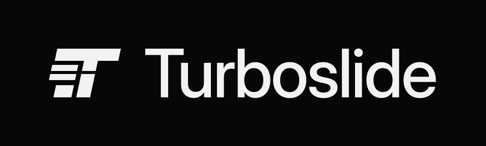

# Turboslide

<picture>
  <source srcset="docs/readme/brand/lockup-light.png" media="(prefers-color-scheme: dark)" width="477">
  
</picture>

Turboslide is a slides editor in the browser. People and agents edit the same presentation: agents run the same 203 actions over the command line, MCP and HTTP.

Use it at https://www.turboslide.com. No account is needed.

## Features

- The editor has menus, a toolbar, keyboard shortcuts and Search the menus (Alt+/), with a filmstrip, layouts, speaker notes and find and replace. It saves as you type, and Version history brings back any earlier version.
- Slides hold text, pictures and logos, shapes and lines, tables, charts and animated patterns, which you can align, group and arrange.
- Nine themes each have a light and a dark appearance, and a brand kit sets your logo, colors, fonts and footer.
- A slideshow runs full screen, and Presenter view shows your notes, the next slide and a timer.
- You share by link or with people by name, with a role for each. Several people can edit at once, follow each other and leave comments.
- The assistant shortens a slide's text, writes its speaker notes or tailors the slide for a customer. Nothing changes until you accept its card.
- Downloads are PowerPoint (each slide as a picture, or editable text), PDF, JPEG, PNG, a web page that presents itself, and a Turboslide file that opens again.

Tools > Advanced tools shows more commands in the menus. The [documentation](https://www.turboslide.com/docs) covers each feature.

## For agents

- Command line: in a checkout, `pnpm exec turboslide <command> --json` runs an action on a presentation folder. See [The command line](https://www.turboslide.com/docs/agents/cli).
- MCP: `pnpm exec turboslide mcp --deck <dir>` serves the actions as tools over standard input and output, and a running studio serves them at `/mcp`. See [MCP](https://www.turboslide.com/docs/agents/mcp).
- HTTP: `POST /api/actions/<id>?deck=<deck>` on a running studio runs one action. See [HTTP actions](https://www.turboslide.com/docs/agents/http).

## Run it on your computer

You need Node 24 and pnpm 11.15.1. Corepack, which ships with Node 24, installs that pnpm from `package.json`.

```sh
git clone --depth 1 https://github.com/Kevin-Liu-01/Turboslide.git
cd Turboslide
corepack enable
pnpm install
pnpm exec playwright-core install --with-deps chromium
pnpm dev
```

The studio runs at http://localhost:4321 and needs no environment variables. Each presentation is a folder under `decks/`, and the studio writes every edit there. The studio keeps its own state, such as its session secret, in `.turboslide/`, which git ignores. Chromium draws the thumbnails, the renders and the downloads.

## Host it yourself

### On your own server

```sh
NITRO_PRESET=node-server pnpm --filter @turboslide/studio build:deploy
PORT=3000 node apps/studio/.output/server/index.mjs
```

Started from the checkout, the server keeps presentations in `decks/`, like `pnpm dev`. Behind a proxy, set `TURBOSLIDE_TRUST_PROXY=1` so the studio reads the forwarded host.

### On Vercel

The project needs a Pro plan, because exports run for up to 800 seconds and a cron job runs every ten minutes.

1. Import the repository with `apps/studio` as the root directory. `apps/studio/vercel.json` sets the build.
2. Create a public Blob store and connect it to the project, which sets `BLOB_READ_WRITE_TOKEN`. Without it, edits last only until the instance restarts.
3. Set the variables below and deploy.

| Variable                     | What it sets                                                    |
| ---------------------------- | --------------------------------------------------------------- |
| `TURBOSLIDE_SESSION_SECRET`  | The key of the browser's identity cookie, 32 characters or more |
| `TURBOSLIDE_DOWNLOAD_SECRET` | The key that signs download links, 16 characters or more        |
| `TURBOSLIDE_TOKEN`           | The first bearer token, for the admin. Agents use API keys      |
| `TURBOSLIDE_PUBLIC_ORIGIN`   | Your site's address, for the page head and the sign in emails   |
| `BLOB_READ_WRITE_TOKEN`      | The public Blob store, set when you connect it                  |

`openssl rand -hex 32` prints a secret. These are optional:

| Variable                                                                   | What it adds                                                                       |
| -------------------------------------------------------------------------- | ---------------------------------------------------------------------------------- |
| `TURBOSLIDE_BLOB_PRIVATE_TOKEN`                                            | A private Blob store for the documents. Pictures stay on the public store          |
| `GOOGLE_CLIENT_ID`, `GOOGLE_CLIENT_SECRET`                                 | Sign in with Google, which also needs an accounts database (`TURBOSLIDE_ACCOUNTS`) |
| `TURBOSLIDE_ROOM_HOST`, `TURBOSLIDE_ROOM_SECRET`, `TURBOSLIDE_ROOM_BEARER` | Live editing through the realtime Worker on Cloudflare (`apps/realtime-worker`)    |

[Run Turboslide yourself](https://www.turboslide.com/docs/self-hosting) lists every variable, and [docs/hosting.md](docs/hosting.md) is the full reference.

## How it is built

Turboslide is a pnpm workspace of TypeScript packages on Node 24, with one Rust crate. A presentation is a typed document: a `deck.json` with one JSON file per slide. Every change, from the editor, the command line, MCP or HTTP, is one action from the table in `packages/schema`. One dispatcher checks its input and applies it, so every surface edits the same way.

| Part                                                | What it does                                                                                                                                                                                          |
| --------------------------------------------------- | ----------------------------------------------------------------------------------------------------------------------------------------------------------------------------------------------------- |
| `apps/studio`                                       | The web app: TanStack Start with React 19 on Vite and Nitro. It serves the editor, the viewer, the slideshow, the docs, and the HTTP and MCP routes for agents.                                       |
| `packages/schema`                                   | The document model: types and Zod schemas, the validator, the migrations, the layouts and the table of 203 actions.                                                                                   |
| `packages/render`                                   | One renderer that turns a slide into HTML and CSS for the editor, the viewer, the slideshow, the screenshots and the exports.                                                                         |
| `packages/viewer`, `packages/chrome`                | The React stage, with selection, handles and snapping, and the editor around it: menus, toolbar, filmstrip and dialogs. The styles are plain CSS on design tokens.                                    |
| `packages/store`                                    | The deck store with versions and slide leases. It writes files under `decks/` in a checkout and to Vercel Blob when hosted.                                                                           |
| `packages/export`, `packages/headless`              | Renders and downloads in headless Chromium through `playwright-core`. PowerPoint files are written with pptxgenjs.                                                                                    |
| `packages/agent`, `packages/mcp`, `apps/cli`        | The dispatcher, the HTTP request rules, the MCP server and the `turboslide` command. The contracts (OpenAPI, `llms.txt`, the MCP tools and the skill references) are generated from the action table. |
| `packages/realtime`, `apps/realtime-worker`         | Live editing and presence through a Cloudflare Worker with Durable Objects. On the hosted studio, its D1 database keeps the accounts, which use better-auth.                                          |
| `packages/effects`, `crates/turboslide-native`      | Dithering and image comparison in Rust, built as a Node addon and as WebAssembly, with a TypeScript copy of the same arithmetic.                                                                      |
| `packages/lint`, `packages/theme`, `packages/fonts` | The slide checks, the nine themes and the catalog of openly licensed fonts.                                                                                                                           |

Vitest runs the unit tests and Playwright runs the browser tests. `pnpm check` runs the whole acceptance chain.

```sh
pnpm generate-routes
pnpm typecheck
pnpm test
```

[AGENTS.md](AGENTS.md) has the rules for working in the repository, and [docs/README.md](docs/README.md) indexes the documents.

## License

MIT ([LICENSE](LICENSE)). Third-party licenses are in [THIRD_PARTY_NOTICES.md](THIRD_PARTY_NOTICES.md).
