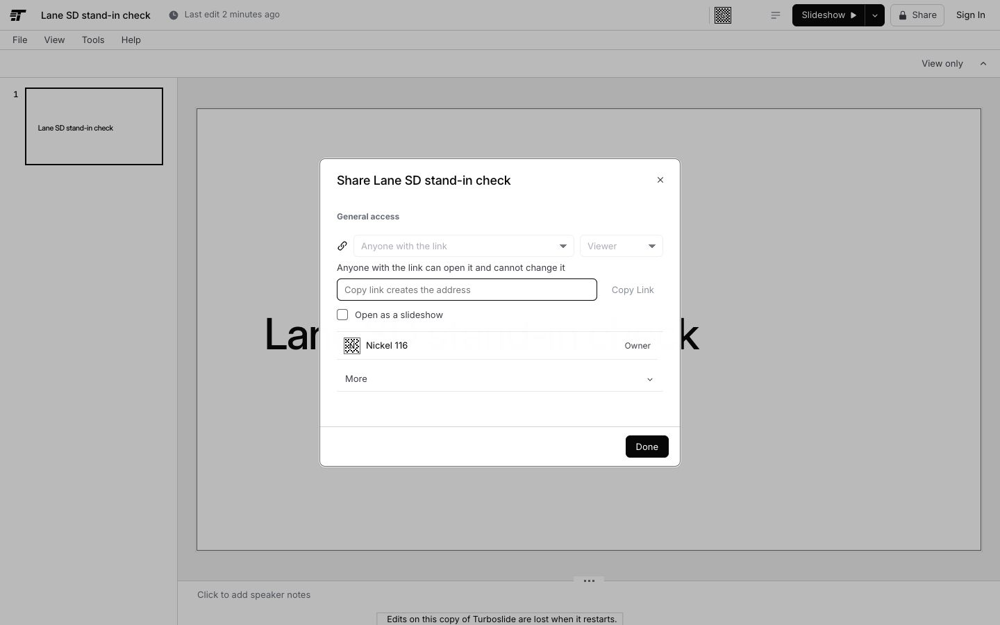

# Lane SD, security of stored data: wave 1 build notes

The lane's wave 1 pushes of `docs/hardening/HARDENING.md` (4.4, 5): HR-SD#5 (#2), HR-SD#6 (#9) and HR-SD#1 (#12). The worktree is `/Users/kevinliu/repos/Turboslide-harden` on `harden/round`. The lane built and tested each push in its own detached checkout of `harden/round` (`scratchpad/sd/wt`, with its own `pnpm install --offline`). It moved each push's files into the shared worktree only inside the git lock, in the same critical section as the commit (4.0, shared files). Port 4855.

## Settings of every local reading

The dev server ran from the lane's checkout on port 4855 with `TURBOSLIDE_STORE=tmp`, `TURBOSLIDE_OVERLAY_DIR=.turboslide/sd-overlay`, `TURBOSLIDE_REALTIME=memory`, `TURBOSLIDE_AUTH_DB=.turboslide/auth-sd.sqlite`, `TURBOSLIDE_MAIL=capture`, the fake Google client, and test values minted for `TURBOSLIDE_SESSION_SECRET`, `TURBOSLIDE_DOWNLOAD_SECRET` and `TURBOSLIDE_TOKEN`, which were never printed. `TURBOSLIDE_LOCAL_OPEN`, `TURBOSLIDE_AUTH_RATE_LIMIT` and `TURBOSLIDE_AUTHORIZE` were unset, as on production. Every timing below carries the one minute load beside it. A timing at a load over 24 is a record, never a verdict.

## HR-SD#5, the thumbnail's cache rule (CRIT-M2)

Commit: the `HR-SD#5` commit, on SA#1 (`120b202f`), which SD#5 waits on in the order of section 5.

What changed. `thumbCacheControl` (`apps/studio/src/server/thumbs.ts`) takes the reader's standing: the decision's `via` when the render route ran `authorize`, or the thumbnail grant's expiry when the URL's `s` stood for the decision. `via: 'open'` and `via: 'publish'` keep the two public values. A grant answers `public, s-maxage=<seconds left>`, at most 60 for an answer that is not the URL's current pixels, never `immutable`. Everyone else, and every 302 to the stored object, answers `private, no-store`.

Readings.

| Reading                                                                                   | Before                                                                                                                                                          | After                                                                                                           | Load     |
| ----------------------------------------------------------------------------------------- | --------------------------------------------------------------------------------------------------------------------------------------------------------------- | --------------------------------------------------------------------------------------------------------------- | -------- |
| `render-thumb-cache.test.ts`, one reader per standing                                     | 3 of 5 red: owner, grant holder, link holder and admin read `public, max-age=31536000, immutable`; the grant answer had no `s-maxage`; the 302 carried the year | 5 of 5                                                                                                          | 97       |
| `thumbs.test.ts` with the route test and SA#1's `safe-equal-sites.test.ts`, on `120b202f` |                                                                                                                                                                 | 19 of 19                                                                                                        | 313      |
| Smoke `restricted thumbnail private`, port 4855                                           | red: `200 public, s-maxage=60, stale-while-revalidate=86400`                                                                                                    | `200 private, no-store`                                                                                         | 149, 291 |
| Smoke `access answer reads enforce`                                                       |                                                                                                                                                                 | 200, `authorize: 'enforce'`, an identity cookie minted                                                          | 291      |
| Smoke `thumbnail without r`, with that cookie, on `gt-brand`                              |                                                                                                                                                                 | 200, `public, s-maxage=60, stale-while-revalidate=86400`, stamp present (51.6 s for the first render, a record) | 291      |
| Smoke `thumbnail with r twice`                                                            |                                                                                                                                                                 | 200 from disk, `public, max-age=31536000, immutable`                                                            | 291      |
| Smoke `scratch deck removed`                                                              |                                                                                                                                                                 | trash 200, remove 200, `deck.info` 404                                                                          | 163      |

After the commit. `tsc -b` on the push's tree (the lane's checkout at `120b202f` with SD#5) exited 0: 24 min 26 s of wall time, 71.6 s of CPU, load 313 at the start and 89 at the end.

Production before the deploy (`71c3556d`, 2026-10-09 00:46 to 00:47 UTC, load 132 to 178), the push's rows alone through the token wrapper, each scratch deck the lane's own and removed by its id:

| Row                                    | Production reads                                                                                                                                                        | Load     |
| -------------------------------------- | ----------------------------------------------------------------------------------------------------------------------------------------------------------------------- | -------- |
| `restricted thumbnail private`         | `200 public, s-maxage=60, stale-while-revalidate=86400` (1015 ms): CRIT-M2 on production itself                                                                         | 154      |
| `thumbnail with r twice` on `gt-brand` | the second answer a CDN HIT of a 302 to the public store with `public, max-age=31536000, immutable`: the CDN keeps the stored object's address for a year under the URL | 132      |
| `thumbnail without r`                  | a 302 to the public store with `public`                                                                                                                                 | 132      |
| `access answer reads enforce`          | 200, `authorize: 'enforce'`, an identity cookie minted                                                                                                                  | 132      |
| `scratch deck removed`                 | `2jhcunsrjkkzx7f5k3ns2owv2y` and `z5pcpbn2ee5ligfycf3ibltixe`: trash 200, remove 200, `deck.info` 404                                                                   | 132, 154 |

So the guard's first pass of SD#5 should read the three thumbnail rows green on the preview and on production: `deck.create` from `blank`, the render of its slide and the removal all answer on production with the bearer. The year long 302 above was cached under the old deployment; Vercel scopes a function answer's CDN entry to its deployment, so the new build should not serve it. If the guard's production pass reads that row red with `x-vercel-cache: HIT` and `public, max-age=31536000, immutable` on a 302, that entry is the cause, not the push.

The smoke readings ran the push's rows alone (a copy of `hosted-smoke.mjs` whose main calls only them), because the page rows of the full table time out on a dev server at a load over 150. The CDN hit itself needs a CDN; on production the restated row reads either a 200 that is a CDN hit and immutable, or, while the seed's thumbnails sit on the public store, a 302 that is `private, no-store`.

Why the smoke sends a cookie. Since H3 a thumbnail request with no identity of its own is refused, so the old `thumbnail with r twice` passed by reading the 403 ("enforce mode: not requested"). The row now asks as a person does. The access route takes same origin requests alone, so the smoke sends `sec-fetch-site: same-origin` and its own origin, as the page's fetch does. `restricted thumbnail private` uses the bearer, which reaches the scratch deck as the admin (`via: 'admin'`), and the row fails on any 200, 204 or 302 that is not `private, no-store`.

What the guard's smoke now writes. With `--token-env`, which the guard always passes, the smoke makes one blank deck through `deck.create` on the deployment it reads, renders one 160 px thumbnail of it, and removes it forever (`deck.trash`, `deck.remove`, then `deck.info` 404). Store removal deletes the deck's `.thumbs/` with the rest of its prefix. A failed removal leaves the id in the `scratch deck removed` row for a hand cleanup.

Cost of the rule, recorded for the performance lane. A card on `/decks` names its revision (`r`) and carries no grant, so its owner's answer was a 302 kept a year by the browser and the CDN, and is now `private, no-store`: each view of `/decks` asks the function once per card (an authorize and up to two Blob `head` calls) where it asked none. Readers of open decks keep the public rules. A browser only rule (`private, max-age=...`) would keep the owner's own copy without a shared cache; the spec's words are `private, no-store`, so the push keeps them and the request below names the choice.

## HR-SD#6, the assets route serves a keyed deck's twins by key (CRIT-M3)

Commit: the `HR-SD#6` commit, on W#1c (`4ce89a00`); it waits on K1#3 (`961dfe0e`), which shares the route in 4.13. The type check and the tests ran on K1#4 (`7cfab1bb`); W#1b and W#1c change dependencies alone.

What changed. `apps/studio/src/server/twin-access.ts` decides which twin `GET /decks/<id>/assets/*` serves and who may keep it; the route asks it first. A keyed deck's twin at `/decks/<id>/assets/<assetKey>/<file>` is served by the key alone (compared with `safeEqual`), with today's `public, max-age=60`; on the blob store the 302 goes to the keyed store path, which names the key the request already holds. On the blob store a request by the file name is served only to a reader the deck admits (`authorize(read)` with the request's identity), with `private, max-age=60`; a stranger gets the answer a missing file gets. A deck without a key of its own keeps its names until K1#4's `rekey` and `delete`, a checkout keeps its folder rule, a tmp store keeps names, and a record that cannot be read refuses on the blob store.

Where this differs from the spec's words, and why. The spec has the name answer 404 to everyone and the route never answer a 302 that names the key. K1#3 recorded that the editor and the presenter build `/decks/<id>/` on the client (`controller.tsx` `ASSET_BASE`, `PresenterPage.tsx` 67, both DROPDOWNS files until DD-C#2), so every picture they draw names the twin by name. A 404 for everyone would blank the pictures of every new deck in the editor and the presenter on the preview and on production. So the name stays open to the deck's own readers, privately (no shared cache keeps the answer), and closed to everyone else. A reader of the deck already reads the key in `/deck`'s asset base, so the private 302 tells them nothing new. Once those two pages take the loader's keyed base, the name answers 404 to everyone: the `mayRead` branch of `twinRequest` leaves (request 4 below).

Readings.

| Reading                                                                                                                                             | Before                                                                                                                                                                                         | After                                                                                                                                                                      | Load     |
| --------------------------------------------------------------------------------------------------------------------------------------------------- | ---------------------------------------------------------------------------------------------------------------------------------------------------------------------------------------------- | -------------------------------------------------------------------------------------------------------------------------------------------------------------------------- | -------- |
| `twin-access.test.ts` (the rule, and the route over a fake blob store whose keyed URL names the key)                                                | the route of `961dfe0e`: 3 of 7 red: a stranger by name got a 302 to the keyed store path (the key handed out), the key form answered 404, the owner's answer by name was `public, max-age=60` | 7 of 7                                                                                                                                                                     | 98       |
| The lane's tests with SD#1 on `7cfab1bb` (`twin-access`, `stand-ins`, `access-stand-in`, `access`, `write`, `access-hooks`, `asset-key`, `headers`) |                                                                                                                                                                                                | 60 of 60                                                                                                                                                                   | 60       |
| Smoke `asset by name 404` on production (`71c3556d`, no keyed layout yet), a scratch deck of the lane's own                                         | a picture of a restricted deck by its file name with no identity: 200, the CRIT-M3 hole on production itself; by key 404                                                                       | (after the deploy, the guard's pass)                                                                                                                                       | 60       |
| The same row's steps on port 4855 (tmp)                                                                                                             |                                                                                                                                                                                                | `asset.add` over HTTP with a data URL 200; `share.get` names the key; by key 200 `image/png`; by name 200, because a tmp store keeps names (the row skips on an http base) | 63       |
| `tsc -b` on `7cfab1bb` with SD#6 and SD#1                                                                                                           |                                                                                                                                                                                                | exit 0, 5 min 6 s                                                                                                                                                          | 61 to 58 |

The production scratch deck `zolaofjiembwdqzgye63olttaa` was trashed and removed (trash 200, remove 200, `deck.info` 404).

## HR-SD#1, no principal ids in answers to a reader without share (DATA-V2)

Commit: the `HR-SD#1` commit, on SD#6 (`6365685b`). It waits on K1#3 (`961dfe0e`), which shares `apps/studio/src/server/access.ts` and comes first in the order of section 5; K1#5a (#11) touches none of its files.

What changed. One module, `apps/studio/src/server/stand-ins.ts`, makes a stand-in for a principal id: `ref_` and 22 characters of an HMAC over the deck id and the principal id under `TURBOSLIDE_DOWNLOAD_SECRET`. It is the same for one person on one deck on every instance and differs between decks, and it is no principal id, so no store path, lookup or index takes it. The reader's own ids, and strings that are no principal id (`seed`, `legacy`, a round one author name), pass through. A reader without the `share` capability (a viewer, a commenter, an editor while editors may not share) now reads:

- `/api/access/<deck>` and the `share.get` route (`access.ts` `shapeRecordFor`): the owner as a stand-in and the own grant with its inviter as a stand-in;
- `share.get` over HTTP and MCP (the record function in `apps/cli/src/records/access.ts`, which the studio runs with `hostedAccessHooks`): the same, through an optional `standIn` the studio passes and a checkout does not;
- the editor loader (`write.ts` `readEditorDeck`): the record as `access.ts` `recordForReader` shapes it (the owner and the creator as stand-ins, the own grants and requests alone, no links, no pending owner, the publisher as a stand-in), the version authors and the lease holders as stand-ins, and the people map keyed by the stand-ins, so the version rows and the Share dialog's owner row still show the name and the mark;
- `version.list` (`write.ts` `listVersions`): the authors as stand-ins.

A share holder's answers are unchanged. The page's code is unchanged: it reads the stand-in as an id and finds the person in the people map by it, which is why the stand-in, and not a missing field, is the shape (the Share dialog and `EditorRoot.tsx` are DROPDOWNS files until DD-C#2).

Readings.

| Reading                                                                                                                                                                                                                                        | Before                                                                                      | After                                                                                                                                     | Load                                                       |
| ---------------------------------------------------------------------------------------------------------------------------------------------------------------------------------------------------------------------------------------------- | ------------------------------------------------------------------------------------------- | ----------------------------------------------------------------------------------------------------------------------------------------- | ---------------------------------------------------------- |
| `stand-ins.test.ts` (the module, `recordForReader`, `shapeRecordFor`, `withStandIns`, `versionsWithStandIns`) and `access-stand-in.test.ts` (`share.get` over HTTP and MCP)                                                                    |                                                                                             | 7 of 7 and 2 of 2                                                                                                                         | 98, 116                                                    |
| The lane's tests with SD#6 on `7cfab1bb`                                                                                                                                                                                                       |                                                                                             | 60 of 60                                                                                                                                  | 60                                                         |
| Port 4855, production's settings, a person makes a deck, opens it by a view link and leaves; a second browser exchanges the link and reads the deck (`apps/studio/e2e/sd-stand-ins.repro.spec.ts`, kept in the lane's checkout, not committed) | `/api/access` names the owner's principal id; 1 of 6 server answers (the loader's) names it | `/api/access` names a stand-in; neither it, `share.get`, the 7 server answers nor the editor page names the owner's id                    | 207 to 335 before; 208 to 223, and 86 to 281 on `f8b68cd2` |
| The viewer's Share dialog                                                                                                                                                                                                                      |                                                                                             | the owner's row reads the owner's own generated label and the word Owner (the run checked the label against `labelFor` of the owner's id) | 86                                                         |
| `tsc -b` on `f8b68cd2` with this push                                                                                                                                                                                                          |                                                                                             | exit 0, 6 min 52 s                                                                                                                        | 100 to 150                                                 |

What a reader still reads. With the owner's browser open on the deck, the viewer's page drew the owner's presence chip with `data-principal` set to the owner's id: the room's presence and its stream entries name every participant and author to every reader, on the memory tier through `room.ts` and on the do tier through the Worker's deck room. The comments surface names authors, mentions and assignees by id to every reader who may read comments, so the loader keeps a comment author's id key beside the stand-in. Both are residuals of DATA-V2 this push does not close (request 5). The private store (K1) closes the index itself: `users/` leaves the public store at the cutover, after which an id names nothing a stranger can read.

## HR-SD#1c, the dispatcher's version answers and the bundle (verifier pass 3, V3-1)

Verifier pass 3 read on `a983c888`: an invited editor whose owner turned Editors Can Share off read the owner's principal id in `version.diff` (the window's Show Changes data and `/api/actions`), in `version.list` through `/api/actions` with the editor's own key, and in `versions/<n>.json` of the zip that File, Download, Turboslide file (.zip) saves. The window's version list was the one version answer with stand-ins; the dispatcher every transport shares returned the stored authors, and the bundle route checked `exportNotes` alone.

- One step over every transport: `deckDispatcher` (`actions.ts`) returns its dispatcher through `dispatcherWithStandIns` (`stand-ins.ts`) when it is built for a request. To a caller who may not share the deck, `version.list`, `version.diff` (each `byAuthor` author), `deck.watch` (the versions and the comment ops) and `activity.list` (each event's actor) name other people by their stand-ins, and so does the lease holder of a 409 on any write or `slide.lease`. Read from the dispatcher and left as they are: `version.save` and `slide.lease` answer the caller's own author; `comment.*`, `notification.*` and `share.get` shape their own answers (F2, HR-SD#1); `presence.list` on the dispatcher names the caller alone; `deck.list` and `account.decks` carry no other person's id.
- The standing: `readerPeople` (`access.ts`) decides on the record without a log line, by the window's rule (the role on the record and its settings), at each call, so a share granted or ended between two calls of one MCP session counts at the next. The window's version list calls it as well. A dispatcher built outside a request (the CLI's rule, a unit test) and a checkout's holder read ids.
- One definition: `authorWithStandIn`, `versionWithStandIns` and `versionsWithStandIns` moved to `packages/identity/src/stand-in.ts`, which the window, the dispatcher and the bundle use. `withStandIns` moved from `write.ts` to `stand-ins.ts`, the server only module, so `write.ts` (in the client graph for its server function stubs) imports no stand-in code.
- The bundle: the route decides the caller's standing and `exportDeckBundle` packs each `versions/<n>.json` with its author as the stand-in (`packDeckDir`'s `version` mapping; an entry the mapping leaves as it was keeps its bytes). Stand-in authors rather than no version log, because a replace removes every stored file the bundle does not carry (`importDeckBundle`): a bundle without its log would end the deck's history on a pull and a push back. With stand-ins the history stays, and in such a round trip only the other authors' ids become stand-ins (their names stay).
- `/api/actions` and `/mcp` pass their request to `deckDispatcher`, which read the same request from the server context before.

| Reading                                                                                                                                                                                                                                                        | Before (`3f10d43c`, push 9b)                                                                                                                                                                                                                               | After                                                                                                                                                                                                                                                 | Load                |
| -------------------------------------------------------------------------------------------------------------------------------------------------------------------------------------------------------------------------------------------------------------- | ---------------------------------------------------------------------------------------------------------------------------------------------------------------------------------------------------------------------------------------------------------- | ----------------------------------------------------------------------------------------------------------------------------------------------------------------------------------------------------------------------------------------------------- | ------------------- |
| `version-stand-ins.test.ts`: the real dispatcher, access store and identity runtime over a file store; the owner's three versions and lease, Editors Can Share off, an invited editor with a key (`read,write,comment,export`) and an invited editor's browser | 4 of 6 red: `/api/actions` `version.list`, `version.diff` (`{from: 1}`, `{staged: true}`, `{}`), `deck.watch` and the 409 of `slide.lease`, the window's `version.diff` and `activity.list`, and the bundle by ticket for both editors name the owner's id | 6 of 6: each answer names the owner by the stand-in and no other principal; the owner's key and the owner's bundle read the id                                                                                                                        | 72 before, 70 after |
| `bundle.test.ts`, the `version` mapping of `packDeckDir`                                                                                                                                                                                                       | red: `versions/2.json` names `usr_owner01`                                                                                                                                                                                                                 | green: the mapped entry carries the mapping, every other entry its bytes, the manifest digests the mapped bytes, the zip unpacks                                                                                                                      | 70                  |
| `tsc -b`                                                                                                                                                                                                                                                       |                                                                                                                                                                                                                                                            | exit 0, 0 errors, 159 s                                                                                                                                                                                                                               | 69 to 103           |
| vitest over the wave's packages (`apps/studio`, `apps/cli`, `apps/render-worker`, `packages/identity`, `agent`, `chrome`, `store`, `realtime`, `schema`, `render`), 120 s timeouts                                                                             |                                                                                                                                                                                                                                                            | 399 of 401 files, 4,470 passed, 2 failed: `banner.test.ts` (this machine's version against `docs/updates.md`) and `packages/realtime` `blob.test.ts` "one head of the pulse per tick" (4 heads in the window, 6 wanted), which passes alone, 27 of 27 | 84 to 100; 83 alone |
| the realtime Worker                                                                                                                                                                                                                                            |                                                                                                                                                                                                                                                            | 64 of 64                                                                                                                                                                                                                                              | 83 to 84            |

## Requests

1. To the orchestrator and HR-0: SD#5, SD#6 and SD#1 ship before HR-0, so HR-0 enters their rows (8.2). The bodies the lane would write. `security.thumbnail.restricted-not-cached`: as a person, make a deck from `/new` (restricted to its creator), read one of its thumbnail URLs with the page's grant and assert `public, s-maxage=N` with N at most 600 and no `immutable`; read it with the cookie and no `s` and assert `private, no-store`; read `gt-brand`'s with the cookie and assert a public value, or `private, no-store` on a 302. `security.assets.by-name-404`: on a blob deployment only (a local tmp store keeps names), add a picture with `asset.add`, read it by name from a second browser that has no standing (404) and by `/decks/<id>/assets/<assetKey>/<file>` (200, or a 302 to `/d/<id>/<assetKey>/`). `security.access.no-principal-ids`: as `sd-stand-ins.repro.spec.ts` does, with the owner's browser off the deck before the viewer reads it (request 5 says why).
2. To the orchestrator, for the performance lane: whether the owner's own card thumbnails on `/decks` may carry a browser only rule (`private, max-age=31536000, immutable` for a stamped answer of the current pixels) in place of `private, no-store`. No shared cache keeps a `private` answer, so the CRIT-M2 rule holds either way; SD#5 keeps the spec's words.
3. To the orchestrator: `docs/readme/docs-index.test.mjs` is red on `harden/round` since the spec commit, because `docs/README.md` does not link `docs/hardening/`. No lane owns `docs/README.md` in 4.13; one line in the docs index closes it.
4. To the orchestrator, after DROPDOWNS DD-C#2: when `apps/studio/src/editor/controller.tsx` (`ASSET_BASE`) and `apps/studio/src/components/PresenterPage.tsx` (67) take the loader's keyed asset base, the `mayRead` branch of `twinRequest` (`twin-access.ts`) leaves and a name answers 404 to everyone, as HR-SD#6 is written. Until then a deck's own readers read its twins by name, privately.
5. To the orchestrator, for the realtime lanes (RT, RC) and the cleanup lane: the rest of DATA-V2's answers half. The room's presence and its stream entries name each participant's and author's principal id to every reader (memory tier `room.ts`; do tier the Worker's deck room), and the comments surface names authors, mentions and assignees by id to every reader who may read comments. `version.list` over HTTP and MCP runs the CLI's `store-actions.ts` and names authors by id to an agent without share. The stand-ins module is the shared rule each can call (`standInsFor(deckId, ownIds)`); the Worker would need the secret per environment.
