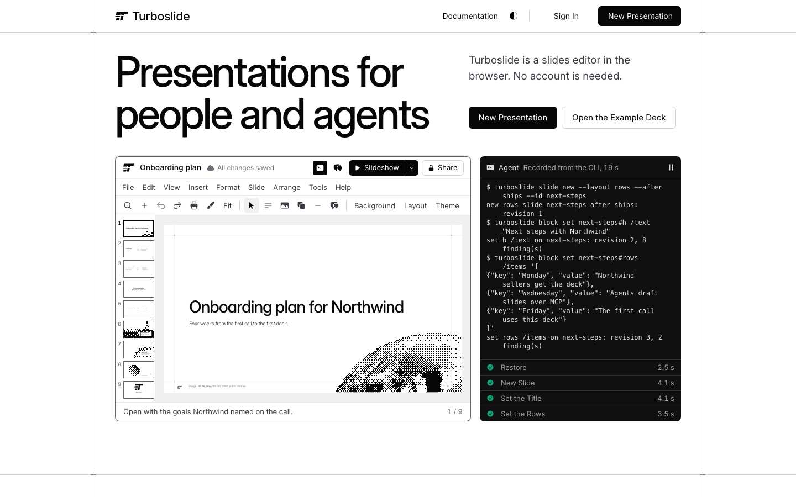
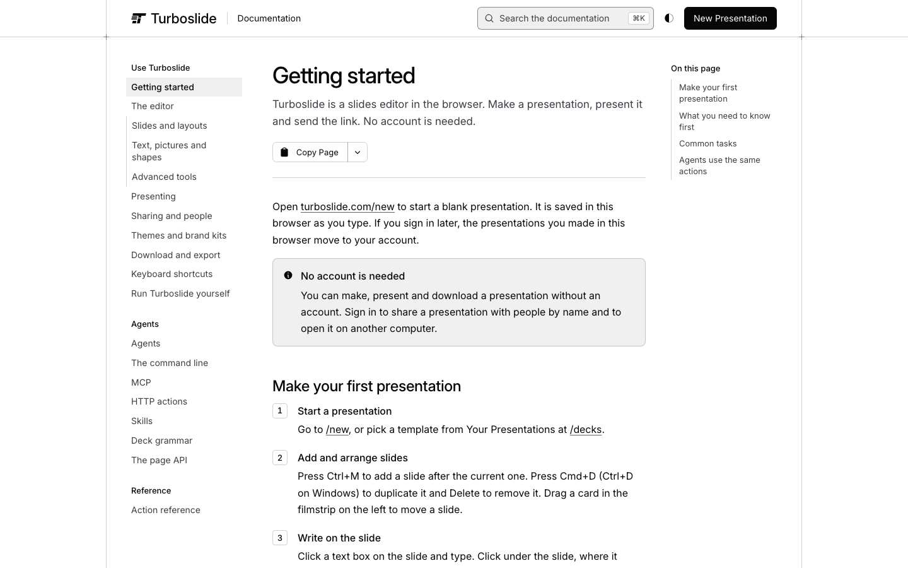

# Lane W, wave 3a: the static pages' headers and policy

The notes of lane W for wave 3a of the hardening round (`docs/hardening/HARDENING.md` 2.4, 4.5, 5): HR-W#3a (SPEC-1, the headers, and WEB-4's static half) and HR-W#3b (SPEC-1, the policy, and CRIT-W5). HR-W#4 waits for seven days of zero `csp` counts on the document routes and HR-W#5 for Kevin's workflow scope; neither is in this wave. Worktree `/Users/kevinliu/repos/Turboslide-harden3`, branch `harden/wave3a` from `origin/main` `f7e97039`. Ports 4856 and 4857 (the lane's), 4870 for the node-server build under `.turboslide/build.lock`. The one minute load was 265 to 530 for the whole lane, so no timing below is a verdict; headers, counts and status codes are the evidence.

This lane restarted. An earlier run of lane W in this workflow wrote the W#3a code at 03:03 to 03:07Z, took the build lock at 03:07Z, built both presets and started the node server on 4870, and stopped there with nothing committed. This run read that work line by line, reproduced the finding, read the build again, fixed one smoke row (`/home/` on a node server is the app's redirect, not a 200), formatted two scripts, committed it, and built W#3b.

## The finding on origin/main

Production serves `origin/main` `f7e97039`. Passive GETs at 04:34Z, load 295 to 303:

| Path                          | Status | Security headers | HSTS               | Cache                                      |
| ----------------------------- | -----: | ---------------- | ------------------ | ------------------------------------------ |
| `/home`                       |    200 | none             | `max-age=63072000` | `public, max-age=0, must-revalidate`, HIT  |
| `/home/`                      |    200 | none             | short              | `public, max-age=31536000, immutable`, HIT |
| `/docs`, `/docs/`             |    200 | none             | short              | page, HIT                                  |
| `/docs/reference/block`       |    200 | none             | short              | page, HIT                                  |
| `/docs/reference/block.md`    |    200 | none             | short              | MISS                                       |
| `/favicon.ico`, `/robots.txt` |    200 | none             | short              | HIT                                        |
| `/`                           |    307 | none             | short              | `x-robots-tag: noindex`                    |

"None" means no `x-content-type-options`, `x-frame-options`, `cross-origin-opener-policy`, `referrer-policy`, `permissions-policy` or policy header of either kind. `/home/` answers the landing page under the screenshots' `/home/**` rule, a year of `immutable`. The page bodies at 04:34Z: `/home` 52 nonce attributes, `/docs`, `/docs/reference/block` and `/docs/shortcuts` 53 each, four pages and four values.

## HR-W#3a: the static answers carry the security headers (`730444e7`)

`STATIC_HEADERS` in `headers.ts` holds the six headers the middleware sets on an https page that is not the embed. `ROUTE_RULES` in `vite.deploy.config.ts` carries them on `/`, `/home`, `/home/`, `/docs`, `/docs/**`, every docs twin, `/favicon.ico` and `/robots.txt`. Nitro writes a header rule as a Vercel route without `continue` (`nitro` 3.0 beta, `generateBuildConfig`, sorted by segment count), and Vercel applies the first such route a path matches, so each rule of those paths carries the whole set; a twin's own rule comes before `/docs/(.*)`, `/docs` is not matched by `/docs/(.*)`, and `/home/` needed a rule ahead of `/home/(.*)`, which also gives it the page's cache header.

| Reading                                                                                                                                           |       Load | Result                                                                               |
| ------------------------------------------------------------------------------------------------------------------------------------------------- | ---------: | ------------------------------------------------------------------------------------ |
| `check-vercel-output.mjs`, a config with `origin/main`'s rules (the build's `config.json` with the six headers and the three new rules taken out) |        300 | 40 of 50: the 10 static header rows red                                              |
| `check-vercel-output.mjs`, the Vercel build of the push                                                                                           |        230 | 50 of 50 (34 docs pages, 34 with the slash, 34 twins)                                |
| hosted smoke on the node-server build, 4870                                                                                                       | 270 to 282 | `static headers /home` 200, `/home/` 307 to `/home`, `/docs` 200, all pass; 43 of 47 |
| `headers.test.ts`                                                                                                                                 |        287 | 23 of 23                                                                             |

The four red smoke rows of that run belong to the local base and to none of this push's files: `json asset attachment` (the attachment rule is a Vercel route only), the two thumbnail rows (30 s timeouts at load 280) and `build commit` (no stamp on a local build). The thumbnails passed on the later run.

## HR-W#3b: one nonce per build and an enforced policy on the prerendered pages (`46b9c94c`)

The build mints one nonce (`prerenderNonce`, kept in `TURBOSLIDE_PRERENDER_NONCE`). TanStack Start sets `TSS_PRERENDERING` before it starts the preview server it prerenders through, and while that is set the middleware hands the build's nonce to every page (`requestNonce`); everywhere else a request mints its own. After the prerender, `staticPagePolicy` (a build plugin in `vite.deploy.config.ts`, `buildApp` with order `post`, after Nitro's and TanStack Start's) adds one route, `continue: true`, to the Build Output's `config.json`, with the header `staticPageCsp` writes through `buildCsp`: the build's nonce, `frame-ancestors 'none'` and the report endpoint, enforced unless `TURBOSLIDE_CSP` reads `report` or `off` at build time. The route names every prerendered page whose file carries the build's nonce alone, with and without the trailing slash. The middleware enforces the same policy on `/home` and `/docs/**` wherever the function answers them (`STATIC_PAGE_ROUTES` in `cspMode`).

Three things this run measured changed the design from the spec's line:

1. **A route rule is wrong on the node server.** On the node-server build the prerendered files are not in Nitro's asset manifest (TanStack Start writes them after Nitro made it), so the function renders `/home` and the docs with the request's nonce. h3 writes a route rule's headers over the answer's (`prepareResponse`, `mergeHeaders(val.headers, preparedHeaders)`), so a policy in the route rules would have named the build's nonce over pages that carry another and blocked their scripts. The header is a Vercel route only.
2. **The route is written after the prerender.** TanStack Start's prerender retry never runs: on an error it calls `addCrawlPageTask(page)` again, which returns at once for a path it has seen, and `failOnError` is never reached. A page that times out is left out of the output without failing the build, and the function answers it on Vercel. Lane W's builds lost pages that way at load 400: the W#3b node-server build skipped `/home` and `/docs/agents` and the final W#3b Vercel build skipped `/docs/agents/cli`, each after one "Encountered error, retrying" line and no second crawl; the W#3a Vercel build of the earlier run held 34 of the 35 docs pages (its log is gone, so the cause there is not read). A route written from the content list before the prerender would have named the skipped page and blocked the function's scripts on it. The plugin names only the files that exist and carry the build's nonce; its log read "35 of 36 prerendered pages carry the build's nonce and its header".
3. **`/home` and the docs enforce in the middleware too.** A node server, a docs address with no page (404) and a page the prerender skipped are answered by the function; with `STATIC_PAGE_ROUTES` they carry the same enforced policy with their own nonce, so `static csp /home` and `/docs` read the same on every base.

| Reading                                                                                                                                                |       Load | Result                                                                                                                                                                                                                                                                                                   |
| ------------------------------------------------------------------------------------------------------------------------------------------------------ | ---------: | -------------------------------------------------------------------------------------------------------------------------------------------------------------------------------------------------------------------------------------------------------------------------------------------------------- |
| `check-vercel-output.mjs`, the first W#3b build (route written before the prerender), all 74 files prerendered                                         |        412 | 55 of 55: 36 pages, 1,907 nonce attributes, one value                                                                                                                                                                                                                                                    |
| the same build's config without the route                                                                                                              |        412 | 52 of 55: `static csp /home`, the docs pages and the docs pages with a slash red                                                                                                                                                                                                                         |
| `check-vercel-output.mjs`, the final build (the plugin)                                                                                                |        431 | 55 of 55: 35 pages, 1,854 attributes, one value; `/home` and `/home/`, 34 docs pages and 34 with the slash enforce it; no policy header from the routes on `/docs/no-such-page`, `/new`, `/decks`, `/deck/gt-brand`, `/docs/index.md`; the route's pattern does not match the skipped `/docs/agents/cli` |
| headers on the node server, 4870                                                                                                                       |        454 | `/home`, `/docs`, `/docs/reference/block` and `/docs/no-such-page` (404) enforce with the request's nonce; `/decks` report only; `/new` enforces                                                                                                                                                         |
| hosted smoke, 4870                                                                                                                                     | 287 to 373 | `static csp /home` and `/docs` pass, the three static header rows pass; 47 of 49                                                                                                                                                                                                                         |
| hosted smoke through a scratch server on 4857 that answers a path from `static/` with the headers its `config.json` routes give and the rest from 4870 | 431 to 451 | the five static rows pass; 48 of 49                                                                                                                                                                                                                                                                      |
| `headers.test.ts`                                                                                                                                      |        443 | 24 of 24                                                                                                                                                                                                                                                                                                 |

The red smoke rows on both bases are `build commit` (no stamp on a local build) and, on 4870, `json asset attachment` (the Vercel only route).

The page probe (`csp-probe.mjs` in the session's scratchpad): Chromium with a `securitypolicyviolation` listener installed before any script, every console line that names a Content Security Policy, and every page error. Load 333 to 436.

| Base                                                                 | Pages                                                                                                                   | Violations, console lines, errors | Navigation to `/new`                                                                                                                                                                                                     |
| -------------------------------------------------------------------- | ----------------------------------------------------------------------------------------------------------------------- | --------------------------------- | ------------------------------------------------------------------------------------------------------------------------------------------------------------------------------------------------------------------------ |
| 4857, the static files with the route's header and the build's nonce | `/home`, `/docs`, `/docs/reference/block`, `/docs/shortcuts`, `/docs/editor/slides`: one nonce value each, the policy's | 0, 0, 0                           | from `/docs` (the docs bar's New Presentation): the editor with 73 controls, 0 violations, the docs page's policy and nonce kept (a navigation inside the page); from `/home` (the hero's): a new document, 0 violations |
| 4870, the function with the request's nonce                          | the same five                                                                                                           | 0, 0, 0                           | both reached the editor with 0 violations                                                                                                                                                                                |

Both pictures were taken by the probe on 4857 after the page settled: the landing's live bands ran (the editor band reads "All changes saved" and the agent band's four checks are green) and the docs page drew its navigation, search and outline, so nothing the pages need was refused.

## Gates

- `tsc -b` over the shared tree: exit 0 on the final W#3b tree (08:35 to 08:41Z, load 389 to 451). The two earlier runs (04:36 to 04:55Z for W#3a and 04:58 to 05:09Z, load 265 to 530) had no error in either push's files and exited 2 on two errors in `apps/studio/src/server/auth/account-delete.ts`, lane SD's uncommitted file for HR-SD#2 at the time.
- The brand lint in enforce mode reads 0 open findings and exits 1 on one stale acceptance, `gt-ui/cta-title-case` for `packages/chrome/src/dialogs/ImportSlides.tsx`, which `origin/main` carries; the competitor guard 9 of 9.
- `core-matrix.test.mjs`, `what-works.test.mjs` and `docs-index.test.mjs` 53 of 53, and `what-works.mjs --check` reads the README current, before each commit.
- Prettier clean on every file of both pushes and on `docs/security.md`.
- The production rule held: production was read with plain GETs only, and nothing was written there.

## Rows

HR-0 is not on `origin/main` (`apps/studio/e2e/core/security.spec.ts` does not exist), so neither push enters its row. `security.static-pages.headers` (W#3a) and `security.static-pages.csp` (W#3b) enter with HR-0, read on its local server; until then each push is pinned by `check-vercel-output.mjs`, `headers.test.ts` and its hosted smoke rows, which the guard runs on every push.

## Requests

- To the orchestrator, for the ship step: W#3a and W#3b touch no file of wave 2 (`git diff origin/main...harden/wave2-ship` is empty over `vite.deploy.config.ts`, `headers.ts`, `hosted-smoke.mjs` and `check-vercel-output.mjs`), so they rebase onto wave 2 without a conflict. On `harden/wave3a` HR-SD#2 (`34e08c3e`) landed between them; section 5 ships W#3b (#54) before SD#2 (#60), and the only file the two share is `docs/security.md`, where W#3b edits sections 8, 12 and 18 and SD#2 section 15, so either order applies. The guard's preview pass reads the new smoke rows: three for W#3a, two for W#3b. Neither push needs a step of Kevin's, a D1 migration or a Worker change.
- To the orchestrator, a residual to schedule (W#4 or a later push): a link from a docs page into the app (the docs bar's New Presentation, measured) is a navigation inside the page, so that editor keeps the docs page's policy, whose nonce is public. The policy still refuses inline handlers, `javascript:` URLs and scripts from other hosts there, which nothing did before W#3b. Making those links full navigations (a plain `<a>` or the router's `reloadDocument`) closes it at the cost of one page load.
- To the orchestrator, a defect outside the round's files: TanStack Start's prerender retry never runs (`start-plugin-core` 1.171.49, `prerender.js`, `addCrawlPageTask` returns for a path in `seen`), so `retryCount: 3` in `vite.deploy.config.ts` does nothing, and a page that times out on a loaded build machine ships as a function page. W#3b's plugin keeps the policy correct either way; the pages' speed is the cost.

## Servers and files

The node server on 4870 and the scratch server on 4857 were stopped before the lane returned, and `.turboslide/build.lock` released. The probe, the scratch server and the readings' raw files live in the session's scratchpad (`w3/`), never in the tree.
